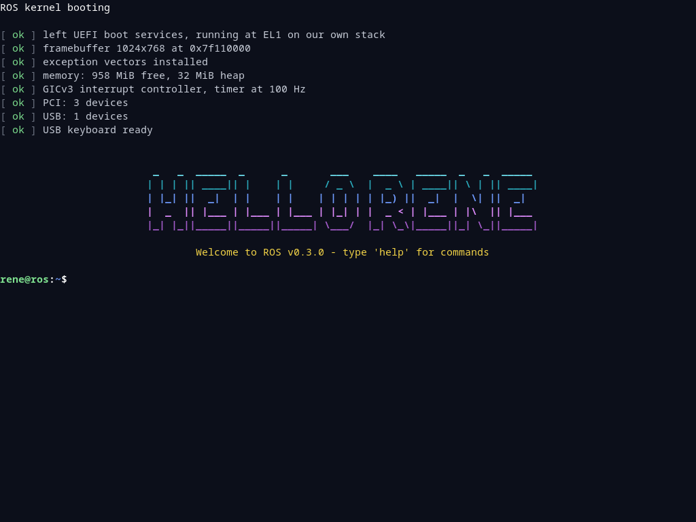
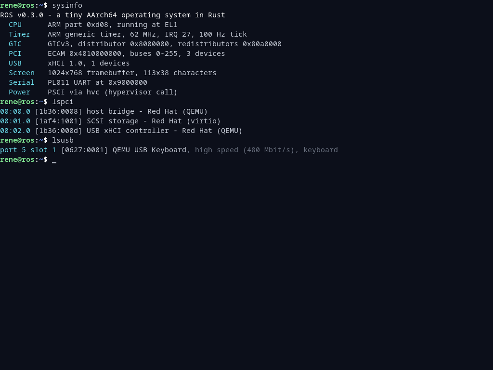
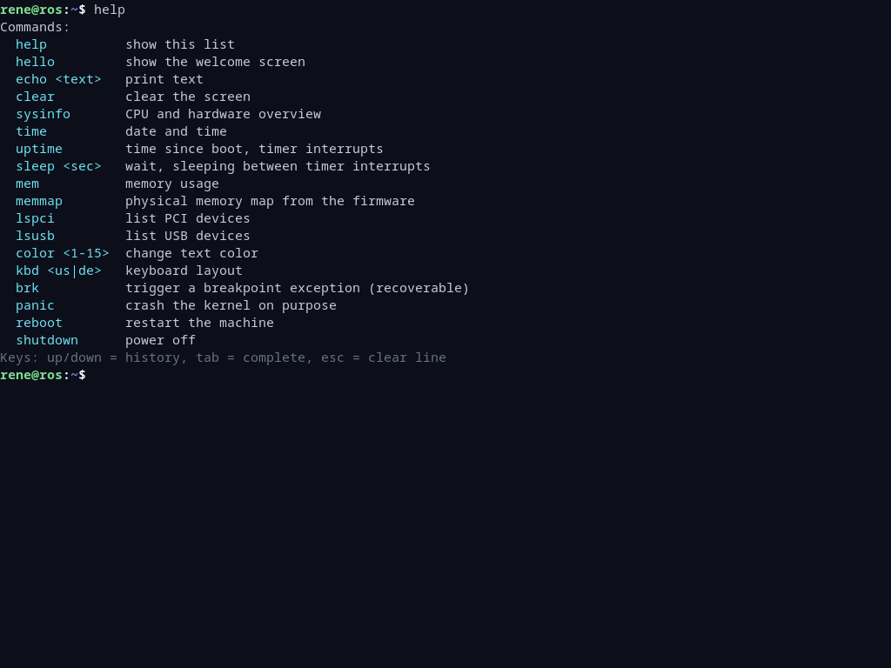
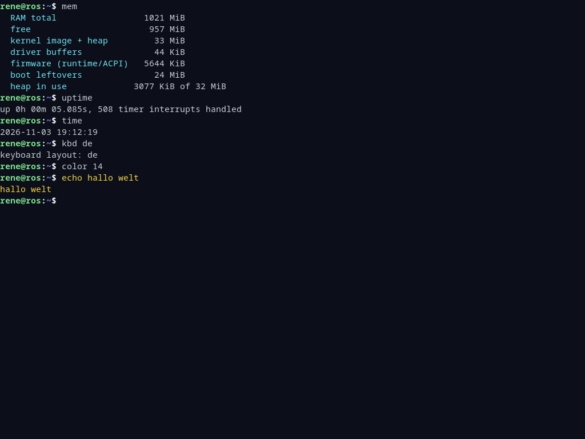
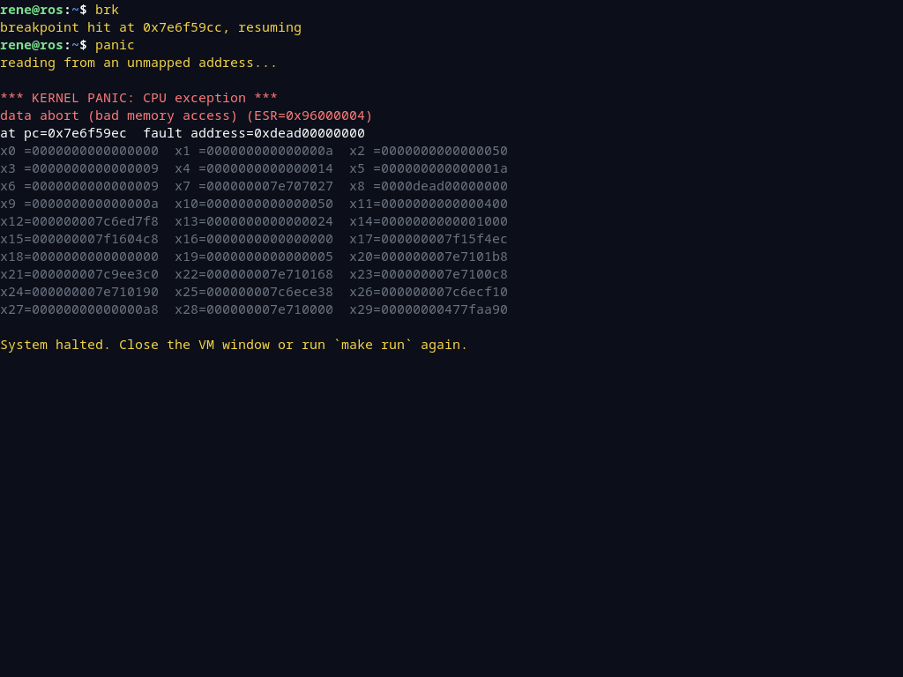
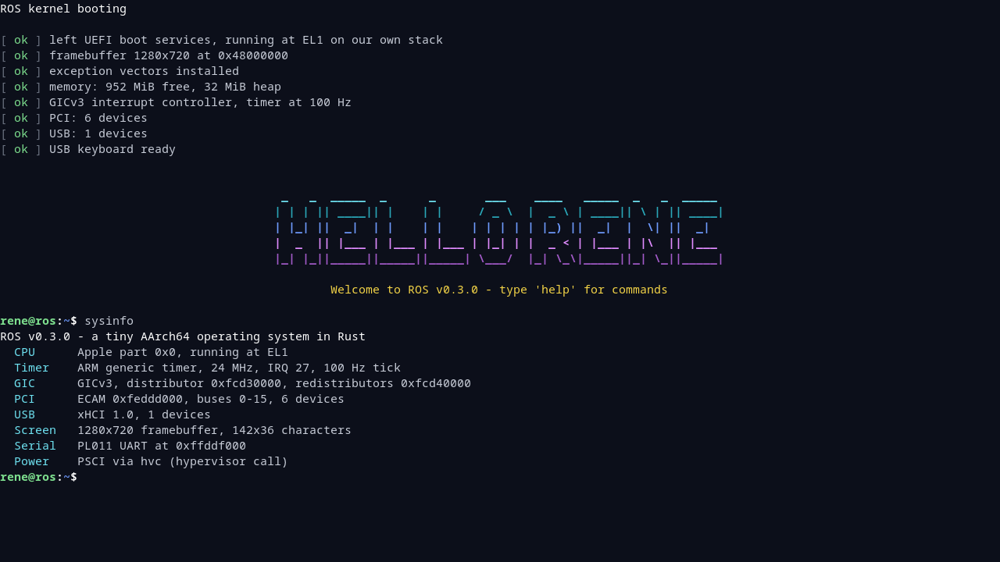

# ROS

[](https://github.com/rene-schakmann/ros/actions/workflows/ci.yml)
[](#license)


A tiny AArch64 operating system written in `no_std` Rust. It boots via UEFI in
QEMU or VirtualBox, greets you with a "HELLO RENE" banner and drops into a small
shell. About 3,000 lines of heavily commented code, small enough to read in a
weekend.



ROS starts as a UEFI application, takes what it needs from the firmware and
then calls `ExitBootServices`. After that the firmware is gone and the kernel
drives the hardware itself, with its own drivers:

| What               | How                                                     |
|--------------------|---------------------------------------------------------|
| Screen             | framebuffer + bitmap font (`noto-sans-mono-bitmap`)     |
| Keyboard           | xHCI USB host controller driver + HID boot keyboard     |
| Interrupts         | exception vector table, GICv3 interrupt controller      |
| Timer              | ARM generic timer, 100 Hz tick                          |
| Hardware discovery | ACPI tables (MADT, MCFG, GTDT, FADT, DSDT)              |
| Devices            | PCI Express enumeration via ECAM                        |
| Memory             | 32 MiB heap + page allocator from the UEFI memory map   |
| Debug log          | PL011 UART (mirrors everything shown on screen)         |
| Power off / reboot | PSCI calls to the hypervisor                            |
| Clock              | UEFI runtime services (they survive `ExitBootServices`) |

The MMU stays on with the firmware's identity mapping (virtual = physical).

## Screenshots

| Hardware overview | Shell commands |
|---|---|
|  |  |
|  |  |

The screenshots are generated by `make screenshots`, which boots ROS in QEMU and
types the commands on the emulated USB keyboard.

## Quick start

You need [Docker](https://www.docker.com/). The Rust toolchain, the disk image
tools and QEMU all live in the build container, and crates are cached in the
`ros-cargo` Docker volume.

```sh
git clone https://github.com/rene-schakmann/ros.git
cd ros
make qemu    # build and boot in QEMU; the shell runs in your terminal (Ctrl-A X quits)
```

### VirtualBox (Apple Silicon)

With VirtualBox 7.2+ on an ARM Mac you get the graphical console:

```sh
make run     # build build/ros.img, create/refresh the VM "ROS" and boot it
make log     # follow the kernel's serial log (build/serial.log)
```

After changing code, run `make run` again. It powers off the VM, swaps in the
new disk and boots.



### Native QEMU with a window

If you have QEMU installed on your host (`brew install qemu`, or
`qemu-system-arm` + `qemu-efi-aarch64` on Debian/Ubuntu), you can see the
framebuffer too:

```sh
make image
qemu-system-aarch64 -machine virt,gic-version=3 -cpu cortex-a72 -m 1024 \
  -bios /opt/homebrew/share/qemu/edk2-aarch64-code.fd \
  -drive if=none,format=raw,file=build/ros.img,id=disk -device virtio-blk-pci,drive=disk \
  -device qemu-xhci -device usb-kbd -device ramfb -nic none -serial stdio
```

## All `make` targets

| Command            | What it does                                                   |
|--------------------|----------------------------------------------------------------|
| `make image`       | build `build/ros.img` (GPT disk, FAT32 ESP, `\EFI\BOOT\BOOTAA64.EFI`) |
| `make qemu`        | boot in QEMU with the serial console in your terminal          |
| `make run`         | boot in VirtualBox                                             |
| `make log`         | follow the VirtualBox VM's serial log                          |
| `make test`        | unit tests                                                     |
| `make check`       | `rustfmt`, `clippy` (kernel and tests) and `rustdoc`           |
| `make smoke`       | boot in QEMU and test the shell end to end                     |
| `make screenshots` | regenerate `docs/screenshots/*.png`                            |
| `make clean`       | remove build output and delete the VirtualBox VM               |

The unit tests build the kernel modules as a normal Linux program, so they need
an AArch64 host: Docker on Apple Silicon, ARM Linux, or the GitHub Actions ARM
runner. If you have Rust installed locally, `cargo build` targets UEFI out of
the box (see `.cargo/config.toml`), and `cargo test-host` runs the tests on ARM
Linux.

## Shell commands

| Command          | Description                                   |
|------------------|-----------------------------------------------|
| `help`           | list all commands                             |
| `hello`          | show the welcome banner again                 |
| `echo <text>`    | print text                                    |
| `clear`          | clear the screen                              |
| `sysinfo`        | CPU, timer, GIC, PCI, USB, screen overview    |
| `time`           | date and time from the real-time clock        |
| `uptime`         | time since boot and timer interrupts handled  |
| `sleep <sec>`    | sleep between timer interrupts                |
| `mem`, `memmap`  | memory usage and the firmware's memory map    |
| `lspci`, `lsusb` | list PCI and USB devices                      |
| `color <1-15>`   | change the text color                         |
| `kbd <us\|de>`   | switch the keyboard layout                    |
| `brk`            | raise a breakpoint exception; ROS handles it and carries on |
| `panic`          | read an unmapped address to show the kernel panic screen |
| `reboot`, `shutdown` | restart or power off through PSCI         |

Keys: up/down = history, tab = complete the command, esc = clear the line.
Typing on the serial console works too.

## How it works

1. The firmware loads `\EFI\BOOT\BOOTAA64.EFI` and calls `efi_main` (`src/main.rs`).
2. `efi_main` reserves heap and stack, picks a screen mode, finds the ACPI
   tables and calls `ExitBootServices`.
3. It switches to the kernel stack and jumps to `kernel_main`.
4. `kernel_main` installs the exception vectors, parses ACPI, sets up the
   console, memory, GIC and timer, scans PCI and initializes USB.
5. The shell runs. It sleeps with `wfi` between timer ticks and polls the keyboard.

[`docs/ARCHITECTURE.md`](docs/ARCHITECTURE.md) walks through each subsystem in
more depth.

| File                | Purpose                                                |
|---------------------|--------------------------------------------------------|
| `src/main.rs`       | UEFI boot stage, `ExitBootServices`, kernel init       |
| `src/arch.rs`       | CPU registers, barriers, IRQ masking, PSCI power       |
| `src/exceptions.rs` | exception vector table (assembly), panic screen        |
| `src/interrupts.rs` | GICv3 + generic timer, uptime, delays                  |
| `src/acpi.rs`       | finds hardware addresses in the ACPI tables            |
| `src/memory.rs`     | heap and physical page allocator                       |
| `src/mmio.rs`       | device register access                                 |
| `src/console.rs`    | framebuffer text console, `print!`/`println!`          |
| `src/serial.rs`     | PL011 UART log and input                               |
| `src/pci.rs`        | PCI bus scan                                           |
| `src/xhci.rs`       | USB host controller, device enumeration                |
| `src/keyboard.rs`   | HID reports → keys, US/DE layouts, key repeat          |
| `src/shell.rs`      | line editor and commands                               |
| `build.mk`          | cargo build + disk image (runs inside Docker)          |
| `scripts/mkvm.sh`   | VirtualBox VM management                               |
| `scripts/qemu.py`   | QEMU runner, end-to-end test and screenshots           |

## Ideas for next steps

- Own page tables: map the kernel and devices yourself, with guard pages.
- Keyboard and USB interrupts via the GIC instead of polling.
- Processes: context switching on the timer tick, user mode (EL0), `svc`
  system calls.
- Read files: a virtio-blk/virtio-scsi driver and a FAT32 reader for the boot disk.
- Multiple CPUs: wake the other cores with PSCI `CPU_ON`.

Contributions are welcome. See [CONTRIBUTING.md](CONTRIBUTING.md).

## Troubleshooting

- **Guru Meditation right at power-on (VirtualBox)**: VirtualBox's ARM EFI
  firmware crashes when the VM has too little RAM (256 MB fails). The script
  uses 1024 MB.
- **Guru Meditation `VERR_NEM_IPE_2` later on (VirtualBox)**: the hypervisor
  can't emulate a device access. All device registers must go through
  `src/mmio.rs` (plain `ldr`/`str`), not `read_volatile`, because the compiler
  may choose load forms with address write-back.
- **"Failed to load the NVRAM store"** after a crash: delete
  `~/VirtualBox VMs/ROS/ROS.nvram` and start again.
- **Nothing happens / black screen**: check `build/serial.log` (VirtualBox) or
  the terminal output (QEMU). Everything on screen is also logged there.
- **`make test` fails with assembler errors**: the tests need an AArch64 host;
  see [All `make` targets](#all-make-targets).

## License

Licensed under either of

- Apache License, Version 2.0 ([LICENSE-APACHE](LICENSE-APACHE) or <https://www.apache.org/licenses/LICENSE-2.0>)
- MIT license ([LICENSE-MIT](LICENSE-MIT) or <https://opensource.org/licenses/MIT>)

at your option.

Unless you explicitly state otherwise, any contribution intentionally submitted
for inclusion in the work by you, as defined in the Apache-2.0 license, shall be
dual licensed as above, without any additional terms or conditions.
